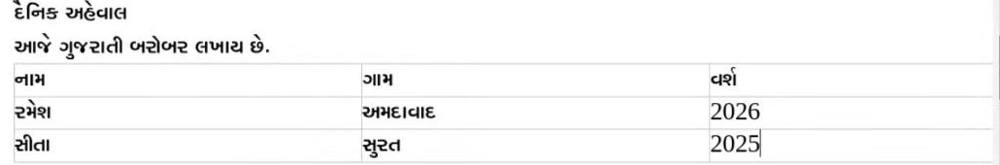
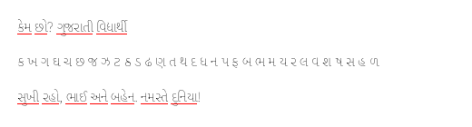
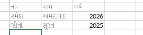

# ગુજરાતી કીબોર્ડ: વાપરવાની રીત

Chromebook ની Linux એપ્સ (LibreOffice, ONLYOFFICE) માં ગુજરાતી લખવા માટે.
ChromeOS ના **Gujarati Phonetic** કીબોર્ડ જેવું જ: અંગ્રેજી અક્ષરોથી ઉચ્ચાર
પ્રમાણે લખો, જેમ કે `kem Cho` લખવાથી **કેમ છો** થાય.

## ૧. લખતાં પહેલાં

- સ્ક્રીનની નીચે જમણી બાજુ કીબોર્ડનું નામ **US** હોવું જોઈએ. ત્યાં GU કે બીજું
  કંઈ હોય તો તેના પર ક્લિક કરીને **US** પસંદ કરો.
- LibreOffice કે ONLYOFFICE ખોલો અને સીધું લખવાનું શરૂ કરો: કીબોર્ડ શરૂઆતમાં
  ગુજરાતીમાં જ હોય છે.

## ૨. ગુજરાતી અને English વચ્ચે બદલવું

શેલ્ફ (સ્ક્રીનની નીચેની પટ્ટી) પર વાદળી **ગુ** બટન છે. તેના પર એક વાર ક્લિક
કરો: ગુજરાતીથી English, ફરી ક્લિક કરો: Englishથી ગુજરાતી.

ક્લિક કર્યા પછી સ્ક્રીનની વચ્ચે બે સેકન્ડ માટે નાની બારી દેખાય છે, જે કહે છે કે
હવે કઈ ભાષા ચાલુ છે:

 

- ભાષા બધી બારીઓમાં એક સાથે બદલાય છે.
- કીબોર્ડ પરથી પણ બદલી શકાય: **Ctrl + Space** (અથવા **Alt + Space**).
- LibreOffice કે ONLYOFFICE ની નીચે લખેલી ભાષા (English – United States)
  ફક્ત સ્પેલિંગ તપાસવા માટે છે; તેનાથી કીબોર્ડ બદલાતું નથી.
- **ગુ** બટન શેલ્ફ પર ન હોય તો: નીચે ડાબી બાજુનું ગોળ બટન (Launcher) ખોલો,
  **ગુજરાતી / English** એપ શોધો, તેના પર right-click કરીને **Pin to shelf**
  પસંદ કરો.

## ૩. કેવી રીતે લખવું

જેવું બોલો તેવું લખો. મોટા અક્ષર (Shift સાથે) લાંબા સ્વર અને બીજા અક્ષરો
આપે છે.

| લખો | મળે |
|---|---|
| `kem Cho` | કેમ છો |
| `gujarAtI` | ગુજરાતી |
| `namaste` | નમસ્તે |
| `vidyArthI` | વિદ્યાર્થી |
| `phariyAda` | ફરિયાદ |
| `tArIkha` | તારીખ |
| `polIsa sTeshana` | પોલીસ સ્ટેશન |
| `amadAvAda` | અમદાવાદ |
| `shrI` | શ્રી |
| `j~nAna` | જ્ઞાન |
| `x` | ક્ષ |

| લખો | મળે | લખો | મળે | લખો | મળે |
|---|---|---|---|---|---|
| `a` | અ | `A` | આ | `aM` | અં |
| `i` | ઇ | `I` | ઈ | `e` | એ |
| `u` | ઉ | `U` | ઊ | `ai` | ઐ |
| `o` | ઓ | `au` | ઔ | `ka` | ક |
| `cha` | ચ | `Cha` | છ | `ta` | ત |
| `Ta` | ટ | `da` | દ | `Da` | ડ |
| `sha` | શ | `Sha` | ષ | `Na` | ણ |
| `La` | ળ | `kha` | ખ | `gha` | ઘ |

- શબ્દ લખતી વખતે છેલ્લો અક્ષર બદલાઈ શકે છે: `k` થી ક, પછી `A` થી કા.
  Space, Enter કે વિરામચિહ્ન (`.` `,` `?`) શબ્દ પૂરો કરે છે.
- શબ્દ લખતાં ભૂલ થાય તો **Backspace** થી સુધારો.
- **Ctrl + S**, **Ctrl + C** જેવા shortcuts હંમેશાની જેમ ચાલે છે.

## ૪. ટેબલ અને સ્પ્રેડશીટ

ટેબલમાં અને સ્પ્રેડશીટમાં પણ ગુજરાતી લખાય છે. **Tab** થી બાજુના ખાનામાં અને
**Enter** થી નીચેની લાઇનમાં જાઓ.

LibreOffice Writer:

ONLYOFFICE ડોક્યુમેન્ટ અને સ્પ્રેડશીટ:

## ૫. ધ્યાનમાં રાખો

- **નવી સ્પ્રેડશીટ** ખોલ્યા પછી એકાદ સેકન્ડ રાહ જુઓ, પછી લખો: પહેલા ખાનાના
  અક્ષરો ક્યારેક છૂટી જાય છે. પહેલું ખાનું એક વાર જોઈ લેવું.
- **ONLYOFFICE** માં શબ્દ અડધો લખ્યો હોય ત્યારે બીજે ક્લિક કરતાં પહેલાં Space
  દબાવો.
- **ૃ** (કૃ, હૃ) હજી લખાતું નથી.
- Chromebook ચાલુ કર્યા પછી કીબોર્ડ તરત ન ચાલે તો: Terminal ના આઇકન પર
  right-click, **Shut down Linux**, પછી LibreOffice ફરી ખોલો.

## ૬. મદદ

કંઈ ન ચાલે કે સવાલ હોય તો:

- ઈમેલ: **vishnurajsreerajn@gmail.com**
- ડેવલપર માટે (ભૂલની નોંધ, English માં):
  <https://github.com/vishnurajsreerajnair/gujarati-phonetic-linux/issues>
